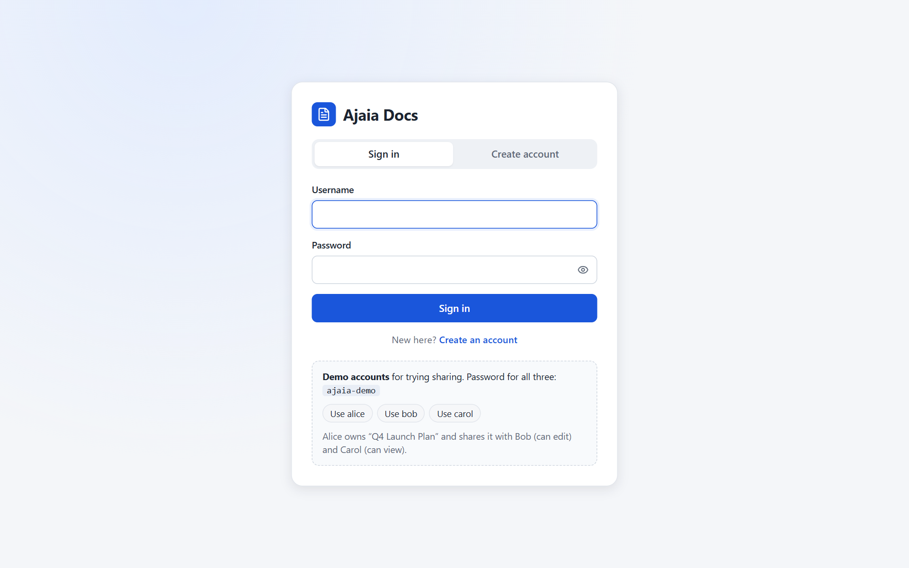
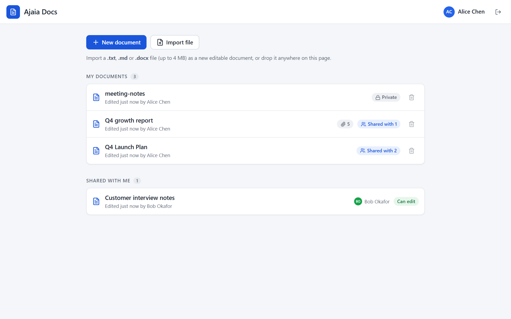
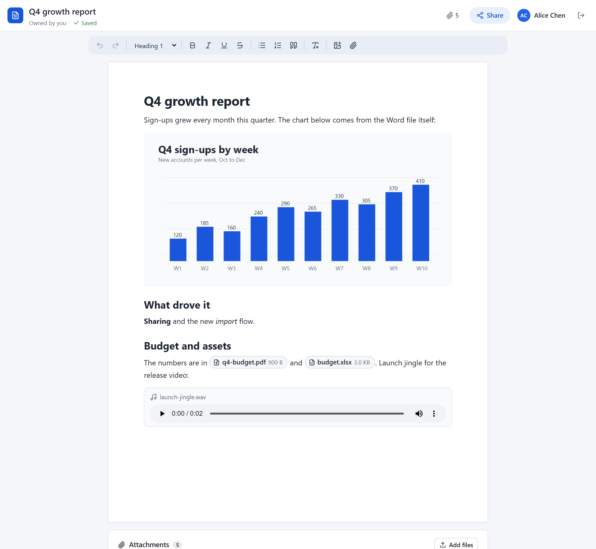
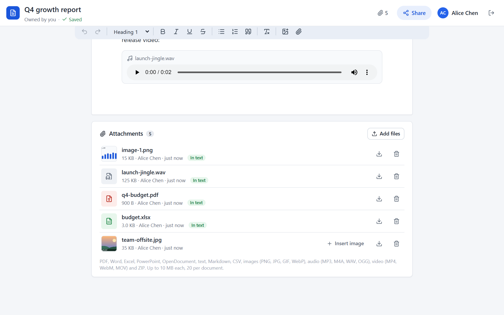
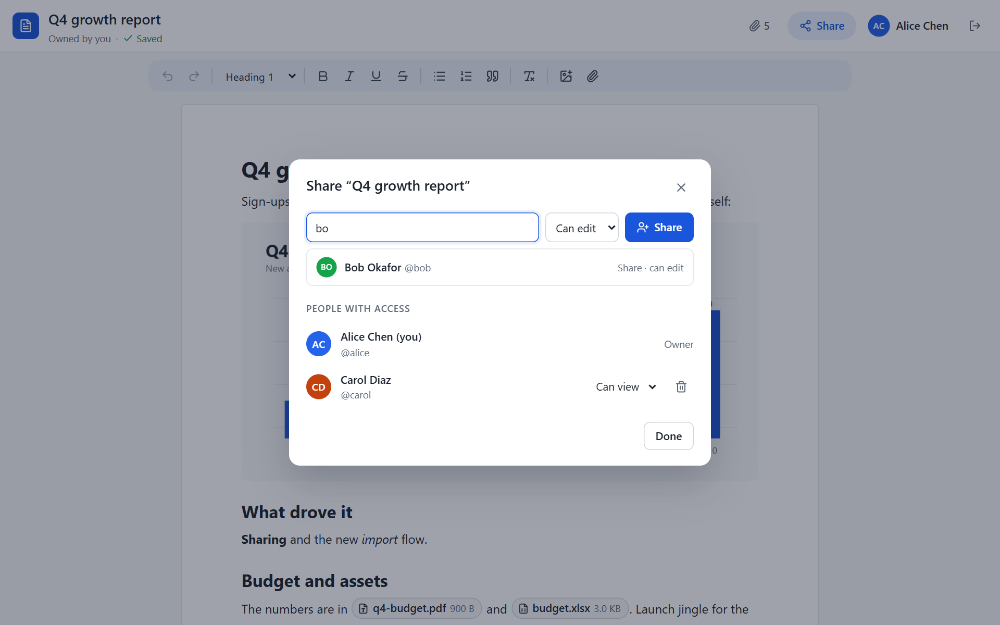
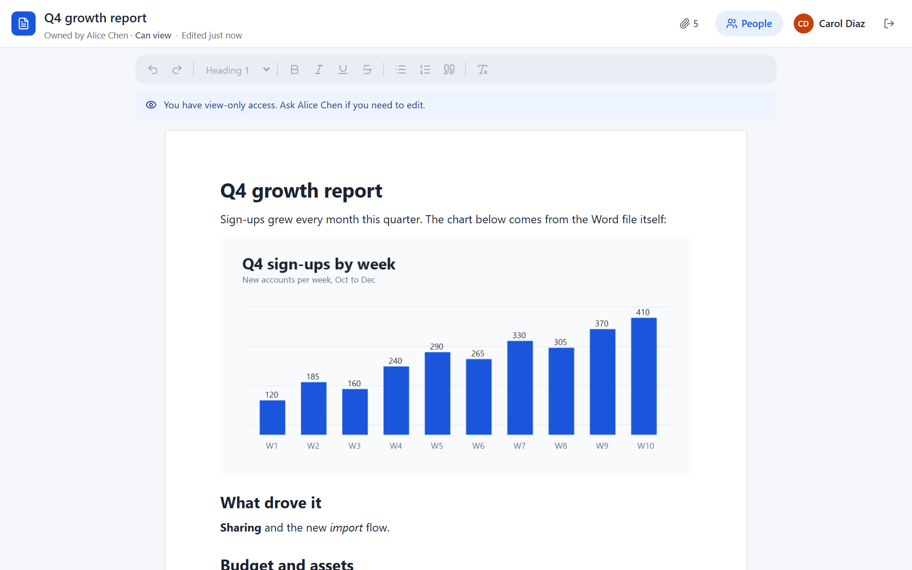

# Submission: Ajaia Docs

A lightweight collaborative document editor: accounts, rich-text editing with autosave, files placed in the document, import from `.txt`/`.md`/`.docx`, and sharing with viewer and editor roles.

## Try it

- **Live app:** _URL added after deployment_
  - Runs on Vercel, with the data in a Turso database, so accounts, documents and files you create stay between visits.
  - The first request after a quiet spell can take a second or two while a server instance starts.
- **Repository:** https://github.com/aimaster-dev/ajaia-docs
- **Sign in:** use a demo account (**alice**, **bob** or **carol**, password `ajaia-demo`; the sign-in page has one-click buttons), or create your own on the *Create account* tab.
- **Two-minute tour:** see [README → Two-minute tour](README.md#two-minute-tour-for-reviewers).
- **Test files:** [`samples/`](samples/README.md) has files that should import, attach, or be refused, with what to expect for each.

No extra setup is needed to try the live app. To run it locally: `npm install`, then `npm run dev`, then open http://localhost:3000 (Node 22.13+).

## What's included

| Item | Where |
| --- | --- |
| Source code | `src/server` (Express API), `src/client` (React + TipTap), `src/shared` (types and rules used by both) |
| Automated tests (58) | `tests/`: accounts, sharing and access control, attachments and embedding, import, database setup and upgrades, autosave. Run with `npm test` |
| Setup and run instructions | [`README.md`](README.md) |
| Architecture note | [`docs/ARCHITECTURE.md`](docs/ARCHITECTURE.md) |
| AI workflow note | [`docs/AI_WORKFLOW.md`](docs/AI_WORKFLOW.md) |
| Screenshots | [`docs/screenshots/`](docs/screenshots/) (6 PNGs, also shown below) |
| Test files for manual testing | [`samples/`](samples/README.md): `import/` (5), `attach/` (11), `should-fail/` (10 committed, plus 2 large ones made by `npm run samples`) |
| Deployment config | `vercel.json`, `api/index.js` and `scripts/build-vercel.mjs` (Vercel: static client plus one bundled serverless function; data in Turso). Also a `Dockerfile` for any Docker host, with `render.yaml` and `railway.json` |
| Project config | `package.json`, `package-lock.json`, `tsconfig*.json`, `vite.config.ts`, `vitest.config.ts`, `index.html`, `public/favicon.svg`, `.gitignore` |
| Sample generator | `scripts/make-samples.ts` (`npm run samples`) |

**Not included on purpose:**
- `node_modules/` and `dist/`, which are rebuilt by `npm install` and `npm run build`
- `data/` (my local database)
- the two oversized test files, which are generated on demand

## Requirements → where they're met

| Requirement | What I built |
| --- | --- |
| Create, rename, edit, save and reopen | New document, inline title rename, TipTap editor, debounced and version-checked autosave (plus Ctrl/Cmd+S); content survives refresh |
| Rich text | Bold, italic, underline, strikethrough, H1–H3, bulleted and numbered lists, quotes, undo/redo, Markdown shortcuts |
| File upload | **Import** `.txt`/`.md`/`.docx` (4 MB) as a new document, keeping Word pictures. **Attachments** (4 MB, 20 per document) placed *in the text*: inline images, audio players, and file chips for PDFs, Office files, video and ZIP. Allowed types are listed in the UI and README; disguised files are refused |
| Sharing | Owner plus per-user **viewer/editor** roles by username, enforced on the server; grant, change and revoke |
| Owned vs shared | Separate "My documents" and "Shared with me" lists, with owner and role badges |
| Persistence | SQLite through libSQL: a local file in development, Turso in production. Migrations; sanitized HTML; files stored with their document; multi-row writes in atomic batches |
| Validation and error handling | zod validation with field-level messages, consistent JSON errors, upload type/content/size checks, rate limits |
| Automated tests | 58 tests across 6 files (see above) |
| Deployment | Vercel (from GitHub, via `vercel.json`) with a Turso database, at the live URL above. Steps in [README → Deploy](README.md#deploy-to-vercel-with-turso) |
| Architecture note and AI note | `docs/ARCHITECTURE.md`, `docs/AI_WORKFLOW.md` |

## Screenshots

| | |
| --- | --- |
|  Sign in, with demo accounts |  Owned vs shared, with role and attachment badges |
|  A Word import with its chart, file chips and an audio player |  The Attachments box: "In text" marks and *Insert* |
|  Sharing by username, with suggestions |  The same document for a view-only user |

## Known limitations

- Not real-time co-editing: conflicts are detected (version check) and others' changes appear within about 4 seconds.
- No password reset, since there's no email.
- Files are capped at 4 MB, the most a Vercel function accepts per request.
- Video is a download chip rather than an inline player.
- Sign-in rate limits are kept in memory, so on Vercel each server instance counts separately.

Details and next steps are in the [architecture note](docs/ARCHITECTURE.md#what-id-do-next).
